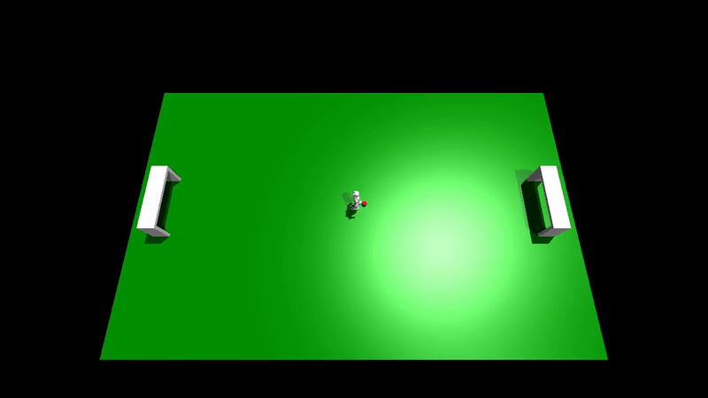

## 环境配置

需要根据[HTWK Gym](https://github.com/NaoHTWK/htwk-gym)，配置好环境

#### 踢足球
```sh
# Train ball kicking behavior
python train.py --task=T1/Kicking

# Test ball kicking
python play.py --task=T1/Kicking --checkpoint=-1
```
## 更新日志
### 2025/12/08

创建了绿色草地和两个球门


### 2025/12/09

添加了全局摄像头和局部摄像头（更改代码：kicking.py 和 kicking.yaml）

可以通过更改帧数间隔（save_interval）保存图片

#### 全局摄像头


#### 局部摄像头


### 2025/12/12

添加了visual_feature_extractor.py文件，用简单的CNN提取视觉特征，并融入到机器人的状态中（更改代码：visual_feature_extractor.py、kicking.py 和 kicking.yaml）

具体效果还没去测试，目前可以运行，后期可以替换更好的神经网络架构

### 2025/12/23

添加了detect_football模块，可以检测出是否有足球并且输出足球的位置

``` 
pip install ultralytics opencv-python pillow
```


### 2025/12/30

修改了visual_feature_extractor.py文件，搭建了可用的网络结构，机器人目前可以碰到球，但是不能把球踢出去


### 2026/01/06

在强化学习（尤其是机器人踢球任务）中，“视觉伺服（Visual Servoing）”能够显著降低算法学习的难度，因为它保证了目标始终在机器人的视野范围内。

由于已经可以使用 YOLOv8 获取足球在图像中的中心坐标，最简单且有效的方法是使用一个 PID 控制器（或简化的比例控制 P） 来动态调整摄像头的旋转角（Pitch 和 Yaw）。

在kicking.py中添加了detect_football模块，通过yolo8自适应调节角度，在第一次识别到足球以后，保证每次读取的画面都包含足球

### 2026/01/28

#### 1. 环境修改 (Environment Modifications)
对仿真环境进行了以下调整：
- **草皮尺寸**：调整为 `14 * 9`
- **球门位置**：已更新
- **地面材质**：去掉灰色地面

#### 2. 方法实现 (Implementation Methods)
目前实现了两种状态输入方法：一种仅依赖关节信息（基准方法），另一种结合了关节信息与视觉信息（我们的方法）。

| 方法类型 | 对应的 Python 函数 | YAML 配置参数 |
| :--- | :--- | :--- |
| **只依赖关节信息**<br>(Joint Only) | **文件**: `kicking.py`<br>**函数**: `_compute_observations` | **文件**: `kicking.yaml`<br>`num_observations: 44`<br>`num_privileged_obs: 20` |
| **关节 + 视觉信息**<br>(Joint + Visual / Ours) | **文件**: `kicking.py`<br>**函数**: `_compute_observations_visual` | **文件**: `kicking.yaml`<br>`num_observations: 96`<br>`num_privileged_obs: 72` |

#### 3. 详细配置说明

**方案 A：只依赖关节信息 (Baseline)**
* `kicking.py` -> `_compute_observations`
* `kicking.yaml`:
    * `num_observations`: **44**
    * `num_privileged_obs`: **20**




**方案 B：关节信息 + 视觉信息 (Ours)**
*  `kicking.py` -> `_compute_observations_visual`
* `kicking.yaml`:
    * `num_observations`: **96**
    * `num_privileged_obs`: **72**

这里只是把关节信息和视觉信息进行拼接，需要优化

