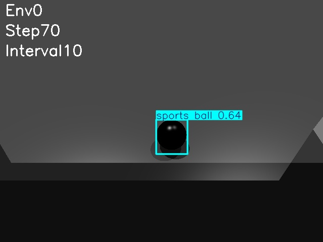

## 环境

需要根据[HTWK Gym](https://github.com/NaoHTWK/htwk-gym)，配置好环境

#### 踢足球
```sh
# Train ball kicking behavior
python train.py --task=T1/Kicking

# Test ball kicking
python play.py --task=T1/Kicking --checkpoint=-1
```
## 修改
### 2025/12/08

创建了绿色草地和两个球门


### 2025/12/09

添加了全局摄像头和局部摄像头（更改代码：kicking.py 和 kicking.yaml）

可以通过更改帧数间隔（save_interval）保存图片

#### 全局摄像头


#### 局部摄像头


### 2025/12/12

添加了visual_feature_extractor.py文件，用简单的CNN提取视觉特征，并融入到机器人的状态中（更改代码：visual_feature_extractor.py、kicking.py 和 kicking.yaml）

具体效果还没去测试，目前可以运行，后期可以替换更好的神经网络架构

### 2025/12/23

添加了detect_football模块，可以检测出是否有足球并且输出足球的位置

``` 
pip install ultralytics opencv-python pillow
```



### 2025/12/30

修改了visual_feature_extractor.py文件，搭建了可用的网络结构，机器人目前可以碰到球，但是不能把球踢出去


